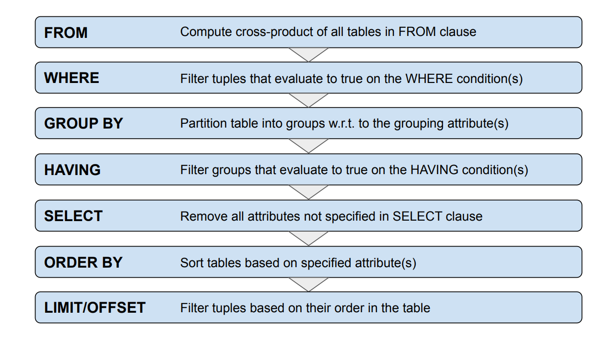

## abc

Structural Constraints: 

Integrity Constraints: boolean check can only inside 1 table, 1 row

foreign key pair (x, y) null is allowed

* PRIMARY KEY
* NOT NULL
* UNIQUE
* FOREIGN KEY
* CHECK

So if we can check the condition inside 1 row, it works (even for implication (->), because if the premise is false, the implication is true). But if we need to check across multiple rows, it doesn't work.

### Entity-Relationship Diagram to Schema

#### Rules

1. **Attribute** $\Rightarrow$ column *(with appropriate domain)*.

2. **Entity Set** $\Rightarrow$ table *(after rule (1))*
   - Identities become **primary key / candidate key (`UNIQUE NOT NULL`)**.

3. **Relationship Set** $\Rightarrow$ table *(after rule (1 & 2))*
   - The **primary key** is the primary key of the participating entity set.
   - We then add **foreign key** to ensure existence.

### Exceptions

1. If **(0,1) participation**  
   $\rightarrow$ the primary key comes from the entity set with **(0,1) participation**  
   *(after rule (1–3))*.

2. If **(1,1) participation**  
   $\rightarrow$ merge the table of the **relationship set** with the **entity set with (1,1) participation**  
   *(after rule (1–3) & exception (1))*.

3. If **weak entity set** *(compulsory (1,1) participation)*  
   → add the **primary key of the owning entity set** into the **primary key of the weak entity set**  
   *(after rule (1–3) & exception (1 & 2))*.

A relationship can have attribute?

## Simple Queries

`SELECT ... FROM ... WHERE ...`

`exp BETWEEN <lower> AND <upper>`: 
```sql
SELECT * FROM countries 
WHERE (continent = 'Asia' OR continent = 'Europe') 
    AND (population BETWEEN 5000000 AND 6000000);
```

`||`: concatenation operator, e.g. 
```sql
SELECT name, 'S$ ' || ROUND((gdp / population)*1.38) AS gdp_per_capita 
FROM countries;
```

`DISTINCT`: removes duplicates, e.g. 
```sql
SELECT DISTINCT continent FROM countries;`
```

`IS NULL`, `IS NOT NULL`: e.g. 
```sql
SELECT * FROM countries WHERE gdp IS NULL`
```
If we use `= NULL`, every expression will evaluated to `UNKNOWN` and the query will return nothing.

`LIKE`: pattern matching:
* `_`: matches any single character
* `%`: matches any sequence of characters (including empty sequence)

## Set Operations

Union-compatible: have the same number of attributes, and the corresponding attributes (match by position not by name) have compatible domain (e.g. CHAR(n), VARCHAR(n), TEXT are compatible).

`UNION`, `INTERSECT`, `EXCEPT`

## Join Queries

```sql
SELECT c.name, n.name
FROM cities AS c, countries AS n
WHERE c.country_iso2 = n.iso2;
```

```sql
SELECT c.name, n.name
FROM cities c INNER JOIN countries n
    ON c.country_iso2 = n.iso2;
```

```sql
SELECT c.name, n.name
FROM cities c JOIN countries n
    ON c.country_iso2 = n.iso2;
```

`NATURAL JOIN`: automatically joins on all attributes with the same name.

`OUTER JOIN`: keep non-matching tuples, fill in NULL for missing attributes.

`LEFT/RIGHT/FULL OUTER JOIN`: keep all tuples from the left/right/full table

`INNER JOIN/JOIN`: only keep matching tuples

## Subqueries

Column alias (optional): 
```sql
SELECT * FROM 
(SELECT n.iso2, n.name FROM countries n WHERE n.continent = 'Asia') 
AS asian_countries(code, name);
```

For these, subquery must return a single column

* `IN <subquery>`: IN can be replaced by INNER JOIN, NOT IN can be replaced by LEFT OUTER JOIN + IS NULL.
  * Special syntax: `continent IN ('Asia', 'Europe')`
* `ANY`/`SOME`
* `ALL`

### Correlated Subqueries

```sql
SELECT name, continent, gdp
FROM countries c1
WHERE gdp >= ALL (
    SELECT gdp
    FROM countries c2
    WHERE c2.continent = continent
      AND c2.gdp IS NOT NULL
);
```
**Scoping rule:** Unqualified columns are resolved **inner → outer**.
So inside `c2`, `continent` means `c2.continent`; thus `c2.continent = continent` becomes `c2.continent = c2.continent` (always true for non-NULL values). Use `c1.continent` explicitly.

`EXISTS <subquery>`: returns true if subquery returns at least one tuple
* Are generally correlated
* Uncorrelated `EXISTS` subqueries are either wrong or unecessary

### Scalar Subqueries

* Subquery returns a single value (single row, single column)
* Can be used as an expression in queries

```sql
SELECT name AS city,
       (SELECT name AS country
        FROM countries n
        WHERE n.iso2 = c.country_iso2)
FROM cities c;
```

Row constructors:
```sql
ROW(population, gdp) > ANY (
    SELECT population, gdp
    FROM countries
    WHERE name IN ('Germany', 'France')
)
```

> **Note:** `ROW(population, gdp)` is a row constructor. It is equivalent to `(population, gdp)`. The comparison operator `>` is applied lexicographically, i.e. first compare the first attribute, if equal then compare the second attribute.
{: .prompt-warning }

### Remarks

* `expr IN (subquery)` is equivalent to `expr = ANY (subquery)`
* `expr1 op ANY (SELECT expr2 FROM ...)` is equivalent to `EXISTS (SELECT * FROM ... WHERE ... AND expr1 or expr2)` if the subquery returns a single value
  * But with `NULL`, `ANY` return `UNKNOWN` while `EXISTS` returns `FALSE`

## Sorting

* `ORDER BY gdp_per_capita DESC;` (or `ASC` for ascending order, default is ascending)
* `ORDER BY n.name ASC, c.population DESC;` (sort by multiple attributes, first by name ascending, if tie then by population descending)

* `LIMIT <n>`: limit the number of rows returned, e.g. `SELECT * FROM countries ORDER BY gdp_per_capita DESC LIMIT 10;` (top 10 countries by GDP per capita)
* `OFFSET <n>`: skip the first n rows, e.g. `SELECT * FROM countries ORDER BY gdp_per_capita DESC LIMIT 10 OFFSET 10;` (countries ranked 11-20 by GDP per capita)

## Common SQL constructs

### Aggregation

* `MAX`, `MIN`, `SUM`, `AVG`, `COUNT`

Every aggregate function ignores `NULL` values, except for `COUNT(*)` which counts all rows.

### Grouping

In principal, (always) use `GROUP BY` with aggregate functions. If you use aggregate functions without `GROUP BY`, the entire result set is treated as a single group.

```sql
SELECT continent,
    MIN(population) AS lowest,
    MAX(population) AS highest,
    SUM(population) AS overall
FROM countries
GROUP BY continent;
```

`IS NOT DISTINCT FROM`: treat `NULL` as a value, so `NULL IS NOT DISTINCT FROM NULL` is true, while `NULL = NULL` is unknown.

`GROUP BY a, b, c, ...`: group by multiple attributes, two tuple in the same group if all these attributes are equal (including NULLs, or `IS NOT DISTINCT FROM`).

Restrictions to `SELECT` clause when using `GROUP BY`: If column A appear in SELECT clause, one of the following must be true:
* A is in the `GROUP BY` clause
* A is an aggregate function (e.g. `MAX(A)`, `COUNT(A)`) or a constant (e.g. `1`, `'hello'`)
* The primary key of table is in the `GROUP BY` clause (candidate key is allowed in standard SQL but not PostgreSQL)

#### `HAVING` clause

Cannot be used without `GROUP BY` clause, typically involve aggregated functions.

```sql
SELECT from_code, to_code,
        COUNT(*) AS num_airlines
FROM routes
GROUP BY from_code, to_code
HAVING COUNT(*) > 12;
```

{: width="972" height="589" }

### Conditional Expressions

```sql
CASE
    WHEN <condition1> THEN <result1>
    WHEN <condition2> THEN <result2>
    ...
    ELSE <default_result>
END
```

* `COALESCE(expr1, expr2, ...)`: returns the first non-NULL expression, e.g. `COALESCE(gdp, 0)` returns 0 if gdp is NULL.
* `NULLIF(expr1, expr2)`: returns NULL if expr1 = expr2, otherwise returns expr1. Can be used to avoid division by zero, e.g. `gdp / NULLIF(population, 0)` will return NULL if population is 0.

## Structuring Queries

### Common Table Expressions (CTE)

```sql
WITH asian_countries AS (
    SELECT iso2, name
    FROM countries
    WHERE continent = 'Asia'
)
SELECT c.name, n.name
FROM cities c JOIN asian_countries n
    ON c.country_iso2 = n.iso2;
```

```sql
WITH
    c1 AS (q1),
    c2 AS (q2),
    ...
SELECT ...
```

There can be multiple CTEs, CTE refers to previous CTEs.

### Views

It is a permanent named query (= virtual table).

The query is stored in the database, but the result is not stored. The result is computed when the view is queried.

No restrictions when used in SQL queries (SELECT statement). But updates to views are restricted.

Updateable views:
* Only one entry in FROM clause (no joins)
* No WITH, DISTINCT, GROUP BY, HAVING, LIMIT, or OFFSET
* No UNION, INTERSECT or EXCEPT
* No aggregate functions
* etc. (incl. no constraint violations)

## Extended Concepts

### Universal Quantification

SQL directly supports existential quantification (e.g. `EXISTS`, `IN`, `ANY`), but not universal quantification (e.g. `FOR ALL`).

### Recursive Queries

```sql
WITH RECURSIVE cte_name AS (
    <base_query>
    UNION [ALL]
    <recursive_query>
)
SELECT * FROM cte_name;
```

## Relational Algebra (RA)

Relational Algebra is a **procedural query language**.

- **Operands:** relations.
- **Operators:** transform one or more input relations into one output relation.
- Basic operators:
  - Unary: selection $\sigma$, projection $\pi$, renaming $\rho$
  - Binary: cross product $\times$, union $\cup$, set difference $-$
- Other RA operators can be expressed using these basic operators.

### Basic Operators

#### Renaming $\rho$

Renaming is used to avoid ambiguous relation or attribute names.

$$
\rho(\text{R}, S(\text{attribute}_1 \rightarrow \text{attribute}_1'))
$$

New names are valid only within the scope of the RA expression.

Rename relation `Managers` to `m` and attribute `office` to `room`:

$$
\rho(\text{Managers}, m(\text{office} \rightarrow \text{room}))
$$

#### Selection $\sigma$

Selection chooses **tuples/rows** that satisfy a condition.

$$
\sigma_c(R)
$$

- Input and output have the same schema.
- Conditions may use:
  - attribute vs. constant
  - attribute vs. attribute
  - $\land$, $\lor$, $\neg$

Find projects managed by Judy:

$$
\sigma_{\text{manager}='Judy'}(\text{Projects})
$$

##### NULL values

Comparisons involving `null` evaluate to **unknown**.

Arithmetic operations involving `null` also evaluate to **null**.

Selection uses **three-valued logic**:

- true
- false
- unknown

A tuple is selected only when the condition evaluates to **true**.

#### Projection $\pi$

Projection chooses specified **attributes/columns**.

$$
\pi_l(R)
$$

- The order of attributes matters.
- Since a relation is a set of tuples, **duplicate** tuples are removed.

Find project names and their team members:

$$
\pi_{\text{pname},\text{ename}}(\text{Teams})
$$

#### Set Operators

A relation is a set of tuples.

* Union $\cup$
* Intersection $\cap$
* Set difference $-$

Find projects Bill works on but Sarah does not:

$$
\pi_{\text{pname}}(\sigma_{\text{ename}='Bill'}(\text{Teams}))
-
\pi_{\text{pname}}(\sigma_{\text{ename}='Sarah'}(\text{Teams}))
$$

#### Union Compatibility

For set operators, $R$ and $S$ must be **union-compatible**:

- Same number of attributes.
- Corresponding attributes have the same or compatible domains.
- Attribute names do not have to be the same.

#### Cross Product $\times$

The cross product forms **all pairs of tuples** from two relations.

$$
R \times S
$$

A cross product is often followed by a selection to keep only relevant pairs.

For all the projects, find the offices of the managers:

$$
\phi_{\text{name}, \text{office}}(\sigma_{\text{manager}=\text{mname}}(\text{Projects} \times \rho(\text{Managers}, \text{M}(\text{name} \rightarrow \text{mname}))))
$$

### Join Operators

A join combines:

- cross product
- attribute selection
- possibly projection

into one operator.

#### Inner Joins - $\theta$-Join

A $\theta$-join allows arbitrary comparison operators in its matching condition.

$$
R \bowtie_\theta S
$$

It is equivalent to:

$$
\sigma_\theta(R \times S)
$$

Join `Projects` with `Managers` where the project manager matches the manager name:

$$
\text{Projects}
\bowtie_{\text{manager}=\text{mname}}
\rho(\text{Managers},m(\text{name}\rightarrow\text{mname}))
$$

#### Inner Joins - Equi Join $\bowtie_=$

An **equi join** is a special case of $\theta$-join where the matching condition uses only equality.

#### Natural Join $\bowtie$

A natural join is a special case of equi join:
- Joins on **all attributes with the same name** in both relations.
- Includes common attributes only once in the output.
- Does not require an explicit matching condition.

$$
R \bowtie S
=
\pi_{\ell}
\left(
R \bowtie_{c}
\rho\left(S, S(a_1 \rightarrow b_1, \ldots, a_k \rightarrow b_k)\right)
\right)
$$

where:
- $a_1, \ldots, a_k$ are the common attributes in $R$ and $S$.
- $b_1, \ldots, b_k$ are new names for the common attributes in $S$.
- $\ell$ is the list of attributes in $R$ and $S$ with common attributes appearing only once.
- $c$ is the conjunction of equality conditions $a_1 = b_1 \land \ldots \land a_k = b_k$.

After renaming `Managers.name` to `manager`:

$$
\text{Projects}
\bowtie
\rho(\text{Managers},m(\text{name}\rightarrow\text{manager}))
$$

The common attribute `manager` is automatically used for matching.

#### Outer Join

$
\operatorname{dangle}(R \bowtie_{\theta} S)
$
= set of dangling tuples in $R$ with respect to $R \bowtie_{\theta} S$.

Therefore,
$
\operatorname{dangle}(R \bowtie_{\theta} S) \subseteq R
$

$
\operatorname{null}(R)
$
= $n$-component tuple of `NULL` values, where $n$ is the number of attributes of $R$.

Left outer join: 

$$
R \;⟕_{\theta}\; S
=
R \bowtie_{\theta} S
\;\cup\;
\left(
\operatorname{dangle}(R \bowtie_{\theta} S)
\times
\{\operatorname{null}(S)\}
\right)
$$ 

- $R \bowtie_{\theta} S$: matching tuples (**inner join**)
- $\operatorname{dangle}(R \bowtie_{\theta} S)$: unmatched tuples from $R$
- $\{\operatorname{null}(S)\}$: NULL padding for the attributes of $S$

Right Outer Join:

$$
R \;⟖_{\theta}\; S
=
R \bowtie_{\theta} S
\;\cup\;
\left(
\{\operatorname{null}(R)\}
\times
\operatorname{dangle}(S \bowtie_{\theta} R)
\right)
$$

Full Outer Join:

$$
R \;⟗_{\theta}\; S
=
R \bowtie_{\theta} S
\;\cup\;
\left(
\operatorname{dangle}(R \bowtie_{\theta} S)
\times
\{\operatorname{null}(S)\}
\right)
\;\cup\;
\left(
\{\operatorname{null}(R)\}
\times
\operatorname{dangle}(S \bowtie_{\theta} R)
\right)
$$

Find employees including employees not assigned to a project:

$$
\text{Employees}
\;⟕_{\text{name}=\text{ename}}\;
\pi_{\text{ename}}(\text{Teams})
$$

Unmatched employees have `null` for attributes from `Teams`.

#### Natural Outer Joins

Natural outer joins are analogous to natural inner joins:

- Equality is used.
- Matching is done over all common attributes.
- Common attributes appear only once.

Types:

- Natural left outer join
- Natural right outer join
- Natural full outer join


### Complex Relational Expressions

Find managers of projects that started in 2025 or later where a team member works at least 30 hours.

Possible intermediate relations:

$$
P := \sigma_{\text{start\_year} \geq 2025}(\text{Projects})
$$

$$
W := \sigma_{\text{hours} \geq 30}(\text{Teams})
$$

Then join the relevant relations and finally project the required attributes.

#### Valid but Not "Smart" Expressions

Some expressions are valid but unnecessarily complicated.

* Cross product + attribute selection instead join
* Unecessary operators
* Query optimization 


### Relational Algebra vs. SQL

#### Relational Algebra

- Procedural query language.
- Query = relational algebra expression / operator tree.
- Uses **set semantics**.

#### SQL

- Declarative query language built on top of RA.
- Focuses on **what** to compute rather than **how**.
- Query = `SELECT` statement.
- Uses **multiset / bag semantics** by default.

SQL:

```sql
SELECT DISTINCT manager, name
FROM Projects
WHERE start_year >= 2025;
```

Conceptually corresponds to:

$$
\pi_{\text{manager},\text{name}}
(
\sigma_{\text{start_year} \geq 2025}
(\text{Projects})
)
$$

SQL queries are translated into relational algebra expressions and then optimized into query execution plans.

`EXPLAIN` can be used to inspect a query plan.

> Note: Basic RA does not have grouping, aggregation, sorting, etc.  
> Extension to RA with formal definitions of most concepts exist – preserve closure property
{: .prompt-info }

## Recommendations & Suggestions

- **(Crude) recommendations when writing an SQL query**
  - Check which information are required for the output ➜ which tables are needed

  - Are some tables need multiple times?  
    *(e.g.: tutorial: student as a lender & student as a borrower)*

  - Are we looking for *"matching"* or *"non-matching"* information:  
    *(in more complex queries, this can often be a combination of both)*

    - **"matching"** ➜ common candidates: **(INNER) JOIN, IN, EXISTS, = ANY, INTERSECT**

    - **"non-matching"** ➜ common candidates: **(OUTER) JOIN, NOT IN, NOT EXISTS, <> ALL, EXCEPT**

  - Favor explicit **JOIN** queries over implicit **NATURAL JOIN** queries

  - **SELECT / ORDER BY** at the very end: "only" for massaging the final output

  - Good habit: always use table aliases  
    *(even if scoping rules ensure correctness)*

  - Good habit: put all attributes you need in the **SELECT** clause into the **GROUP BY** clause  
    *(even if they can be unambiguously be derived from primary key relationships)*

```sql
SELECT A, B, COUNT(*)
...
GROUP BY A, B;
```
rather than just using `GROUP BY A` and relying on the DBMS to infer that B is determined by A.

## Basic Sanity Checks

- JOIN queries (both INNER & OUTER)
  - Most of the time, you **do not want to compute the cross product / Cartesian product** (use JOIN instead)
  - Multiple tables in **FROM** clause?
    - ➜ Check if corresponding attribute selection is present somewhere

- EXISTS queries
  - **(NOT) EXISTS** subqueries are generally always correlated
  - Uncorrelated **(NOT) EXISTS** subqueries are either wrong or unnecessary

- Big No-Nos
  *(those would throw an error but no use with pen & paper)*
  - **SELECT** clause with attributes and aggregated attributes without **GROUP BY** clause
  - **HAVING** clause without **GROUP BY** clause

- Ask yourself:
  - Do I need **DISTINCT**?
  - Can **NULL** mess up my result?
