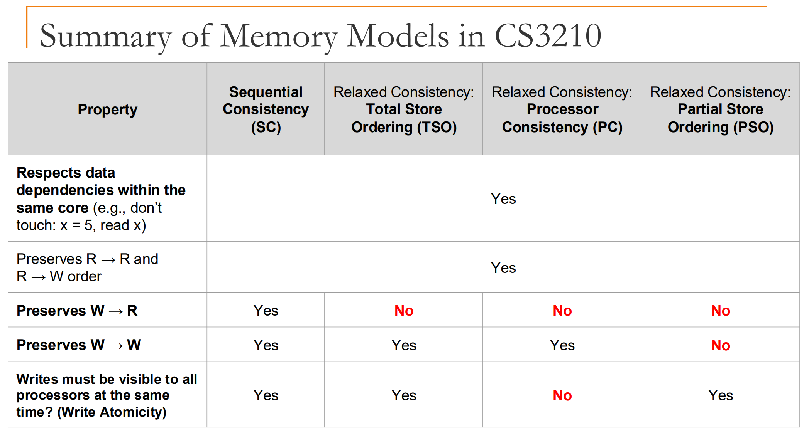

[CUDA](https://docs.nvidia.com/cuda/cuda-programming-guide/01-introduction/programming-model.html)

## Lecture 7: Memory Consistency

* (Cache) Coherence: how to handle multiple cached copies when multiple cores read/write to the same memory location (synchronization)
  * Overhead: affects multiple cores writing to the same memory location or cache line
* (Memory) Consistency: what is the order of reads/writes to different memory locations should be observed (order of events)
  * Overhead: affects multiple cores writing to different memory locations

### Cache Coherence

Coherence defines the behavior of reads and writes to the same specific memory location.

It ensures that all PU has consistent view of memory, order of reads/write to the same memory location

Three properties of cache coherence:
* Program order: A core's memory operations to the same location must appear in the order that core issued them
* Write propagation: writes from a core should become visible to other cores eventually
* Transaction serialization: all cores should agree on the order of writes to the same memory location

How to solve cache coherence problem in multiprocessor systems:
* If a given core's block is **invalid**: reads fetch data from memory, but force other caches to write-back new data to memory first
* If a given core's block is **valid**: it can read from it, but writing to it invalidates all other cores' copies

> Therefore, the implementation usually enforces the properties at cache-line/block granularity, not at the individual memory location level.
{: .prompt-tip }

Cache coherence protocols enforced by hardware **cache controllers**:
* Snooping based: There is some shared communication medium (e.g. shared bus) between caches <-> memory. Each cache maintains state of own cache blocks, when a cache block is written, it broadcasts the write, all other caches sees the broadcast and invalidates their copies if they have it.
  * Pros: Simple, low metadata overhead
  * Cons: lots of broadcasts, shared bus doesn't scale well
* Directory based: No shared bus, keep metadata in a centralized directory, which keeps track of which caches have copies of which blocks. When a cache wants to write to a block, it sends a request to the directory, which then invalidates other caches' copies.
  * Pros: Scales better than snooping, less broadcast traffic, work well with mesh/NUMA (the directory can be distributed across memory nodes, with each node tracking the cache sharers for its own memory blocks)
  * Cons: More complex, higher metadata overhead

Implications of cache coherence:
* increases memory latency in multiprocessor systems
* lower the hit rate in cache
* Cache ping-pong: two PUs keep writing to the same cache line, causing slow fetch from L3 or main memory
* False sharing: two PUs write to different memory address (but same cache line)

### Memory Consistency Models

Contrains the order in which memory operations performed by one thread become visible to other threads for different memory locations. 

#### Sequential Consistency

Four types of memory ordering requirements:
* Write-to-read: write to X must commit before subsequent read from Y
* Read-to-read: read from X must commit before subsequent read from Y
* Read-to-write: read from X must commit before subsequent write to Y
* Write-to-write: write to X must commit before subsequent write to Y

In a sequentially consistent memory system, all four memory operation orderings are preserved. That means there exists a total order of all memory operations that is consistent with the program order of each thread.

#### Relaxed Consistency

Relax the ordering of some memory operations **only if** no data dependency between operations.

Depedencies: if two operations from the same thread access the same memory location, and at least one of them is a write, then there is a dependency between them:
* R-W: anti-dependency (WAR)
* W-W: output dependency (WAW)
* W-R: flow dependency (RAW)

##### Write-to-read (W-R)

Allow a read on PU to be reordered before a previous slower write on the same PU to hide the write latency.

Use FIFO write buffer to store writes.

* Total Store Ordering (TSO):
  * A PU can read B before its earlier write to A becomes globally visible to other PUs (W → R may be relaxed).
  * Write atomicity is preserved: once a write becomes visible to one other PU, it is considered globally visible to all other PUs.
  * Write-to-Write order is preserved: if a PU writes A and then B, A becomes globally visible before B.
  * R-W and R-R are preserved also

* Processor Consistency (PC):
  * Write atomicity is not preserved: a write may become visible to some PUs before others, but eventually all PUs will see the write.
  * W-W, R-W, and R-R are preserved

```C++
// initialization
A = 0;
B = 0;

// core 1
A = 1;

// core 2
while (A == 0) { /* spin */ }
B = 1;

// core 3
while (B == 0) { /* spin */ }
print(A);
```

Under SC/TSO, the output of core 3 is guaranteed to be 1.

But under PC, A can be printed as 0 in core 3, because core 2 may see the write to A before core 3 does, and core 3 may see the write to B before core 2 does.

> It does not violate W-W because two writes to A and B are from different PUs, and there is no dependency between them.
{: .prompt-tips }

#### Write-to-write (W-W)

Writes can bypass earlier writes (to different locations) in write buffer (non FIFO write buffer), hiding the write misses latency.

Partial Store Ordering (PSO):
* Relax W-R order, similar to TSO
* Relax W-W order
* Preserve write atomicity

{: width="972" height="589" }

> x86-64 implements TSO, so C++ relaxed/acquire (need RR, RW) loads and relaxed/release (need RW, WW) stores usually compile to plain MOVs; acquire/release require no extra hardware fence, though they still constrain compiler reordering.
{: .prompt-info }
